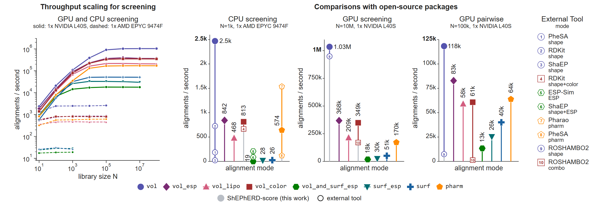
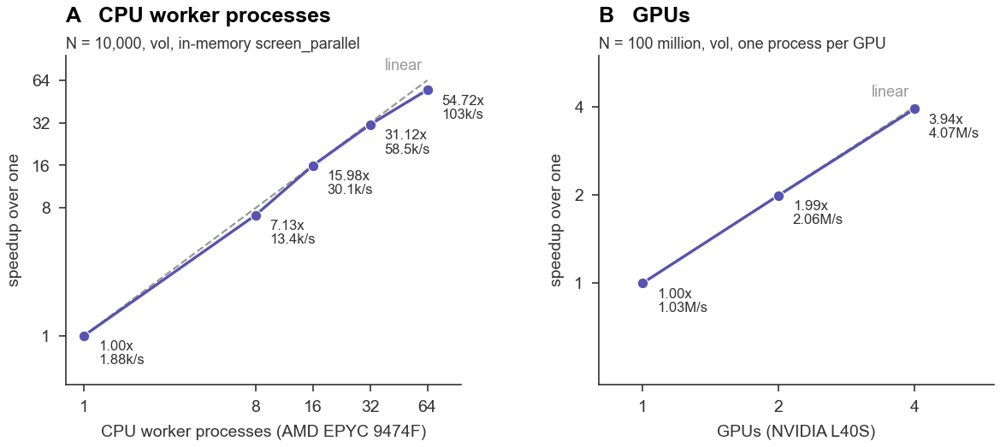

# Alignment throughput

**Procedure.** Timings run after warmup and do not include:

- molecular preparation (building conformers, surfaces and so on),
- building the screening index,
- assembling the batches of pairs for pairwise alignment.

On GPU, the Triton kernels use fixed, pre-tuned settings.

**Hardware.** GPU: NVIDIA L40S. CPU: a single AMD EPYC 9474F core, running Numba 0.59.1 with SVML.

*Left: screening throughput versus library size on one GPU (solid) and one CPU
core (dashed). Right: CPU screening ($N=10^3$), GPU screening ($N=10^7$) and GPU
pairwise alignment ($N=10^5$), with external tools shown as open numbered markers.*

GPU screening throughput rises with library size as larger batches fill the
GPU, levels off above $N=10^5$, and stays there through $N=10^7$.

## Main modes

Alignments per second. $N$ is the number of conformers screened or pairs
aligned. Pairwise results use 250 query compounds and 400 disjoint library
compounds, one conformer each.

| Mode | CPU screen $N=10^3$ | CPU pairwise $N=10^3$ | GPU screen $N=10^5$ | GPU screen $N=10^7$ | GPU pairwise $N=10^5$ |
|---|---:|---:|---:|---:|---:|
| `vol` | 2,470.5 | 2,020.2 | 904,715 | 1,034,608 | 118,293 |
| `vol_esp` | 841.6 | 797.4 | 363,972 | 368,212 | 82,823 |
| `surf` | 25.7 | 37.5 | 51,327 | 50,726 | 40,090 |
| `surf_esp` | 28.2 | 34.7 | 32,510 | 29,838 | 25,863 |
| `vol_and_surf_esp` | 19.0 | 19.4 | 18,049 | 17,839 | 13,401 |
| `pharm` | 574.1 | 515.2 | 165,546 | 170,039 | 63,658 |
| `vol_color` | 813.0 | 682.0 | 332,361 | 348,793 | 60,728 |
| `vol_lipo` | 468.4 | 409.8 | 215,118 | 209,397 | 58,493 |

At these GPU pairwise rates, one million conformer pairs take 8.5 s (`vol`) to
75 s (`vol_and_surf_esp`).

## Additional modes evaluated in the SI

Same workloads as above. These modes were not run at $N=10^7$.

| Mode | CPU screen $N=10^3$ | CPU pairwise $N=10^3$ | GPU screen $N=10^5$ | GPU pairwise $N=10^5$ |
|---|---:|---:|---:|---:|
| `vol_pharm` | 280.0 | 234.0 | 98,648 | 39,251 |
| `vol_atomtype` | 267.7 | 258.6 | 258,022 | 57,971 |
| `vol_mr` | 323.2 | 294.3 | 214,050 | 57,154 |
| `surf_tversky` | 20.6 | 37.5 | 38,053 | 31,136 |
| `surf_esp_tversky` | 19.6 | 34.7 | 32,472 | 25,846 |
| `vol_and_surf_esp_tversky` | 19.0 | 19.5 | 18,112 | 13,071 |
| `vol_color_tversky` | 789.8 | 678.6 | 331,031 | 61,817 |
| `vol_lipo_tversky` | 475.3 | 406.2 | 211,608 | 51,847 |
| `pharm_tversky` | 572.6 | 510.0 | 163,818 | 62,641 |
| `vol_fukui` | 461.7 | 409.7 | 213,585 | 58,101 |

`vol_tversky`, `vol_esp_tversky`, `vol_avoid`, `vol_color_avoid` and `vol_color_avoid_tversky` were not timed. The `_tversky`
names are the registry modes that `similarity="tversky"` runs on the batched backends.

## Comparison with open-source tools

Alignments per second on the same hardware and workloads as above. Dashes
mark configurations that were not measured or that the tool does not provide.

| Tool | Mode | CPU screen $N=10^3$ | CPU pairwise $N=10^3$ | GPU screen $N=10^5$ | GPU screen $N=10^7$ | GPU pairwise $N=10^5$ |
|---|---|---:|---:|---:|---:|---:|
| `shepherd-score` | `vol` | 2,470.5 | 2,020.2 | 904,715 | 1,034,608 | 118,293 |
| RDKit | `vol` | 726.2 | – | – | – | – |
| PheSA | `vol` | 186.0 | – | – | – | – |
| ShaEP | `vol` | 22.5 | – | – | – | – |
| ROSHAMBO2 | `vol` | – | – | 887,880 | 948,736 | 7,415 |
| `shepherd-score` | `vol_color` | 813.0 | 682.0 | 332,361 | 348,793 | 60,728 |
| RDKit | `vol_color` | 666.5 | – | – | – | – |
| ROSHAMBO2 | `vol_color` | – | – | 141,254 | 170,289 | 1,323 |
| `shepherd-score` | `pharm` | 574.1 | 515.2 | 165,546 | 170,039 | 63,658 |
| PheSA | `pharm` | 179.7 | – | – | – | – |
| Pharao/Align-it | `pharm` | 1,533.4 | – | – | – | – |
| `shepherd-score` | `vol_and_surf_esp` | 19.0 | 19.4 | 18,049 | 17,839 | 13,401 |
| ShaEP | `vol_and_surf_esp` | 22.5 | – | – | – | – |
| ESP-Sim | `vol_and_surf_esp` | 187.1 | – | – | – | – |

## Parallel screening

CPU scaling uses 10,000 conformers and includes pair construction inside each
persistent worker's timed call. 64 workers provide a 54.7x speedup using the
in-memory `screen_parallel` function (not store-based `screen`).

GPU scaling uses 100 million conformers with one host compute thread per GPU
worker. One through four L40S GPUs lead to speedups of 1.99-3.94x, respectively.

Many CPUs run two hardware threads per physical core (SMT, or hyper-threading),
and the OS counts each thread as a logical CPU. In one measurement, using the
second thread on a core made the Numba kernels only about 10% faster, whereas a
second physical core made them about 1.8x faster. For best throughput, use one
worker per physical core. Full description of benchmark procedures are in the
[benchmarks repository](https://github.com/Nate-Somers/Shepherd-Score-Benchmarks).
